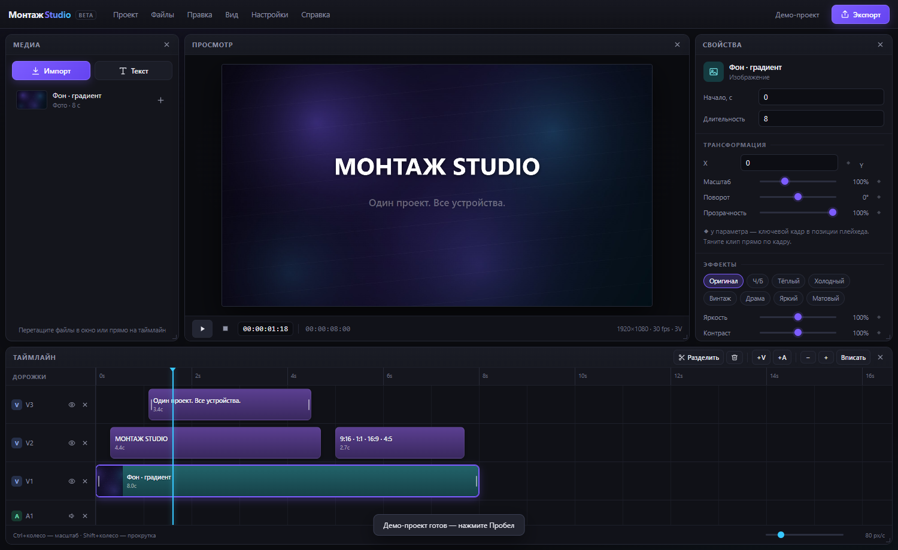
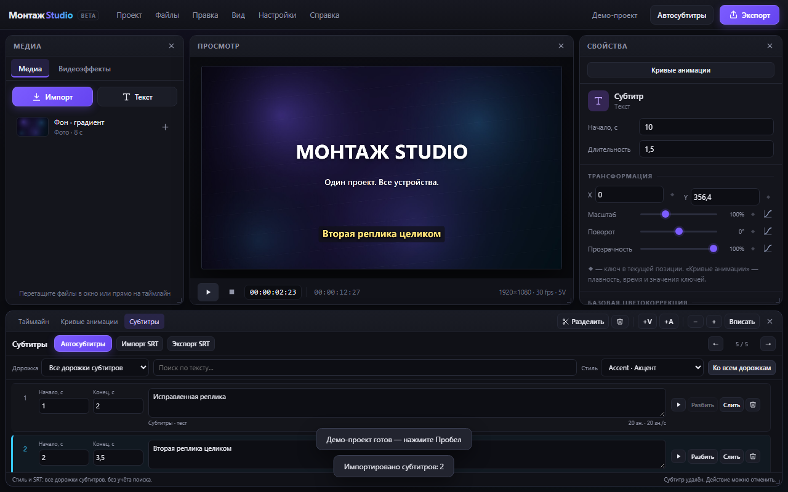
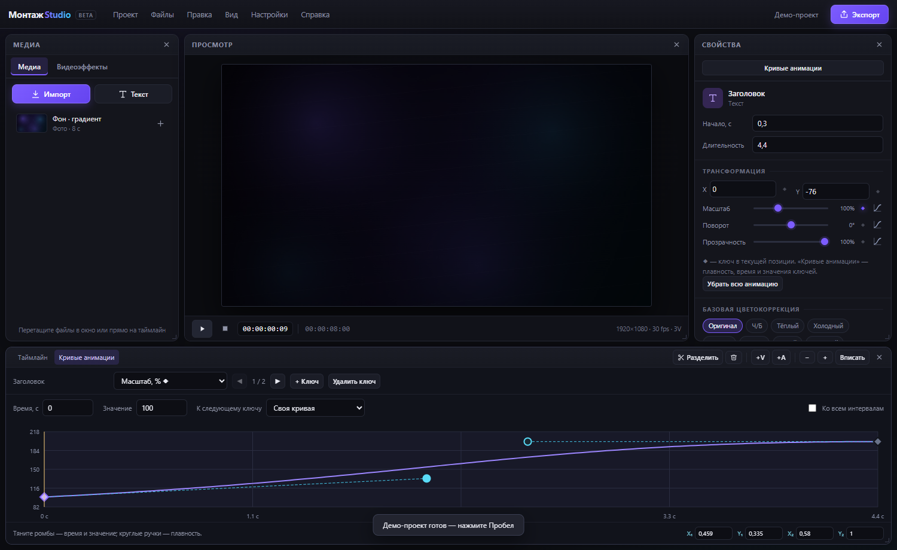

# Монтаж Studio

Видеоредактор для Windows и Android: многодорожечный таймлайн, эффекты, ключевые кадры с кривыми, автосубтитры офлайн (whisper.cpp) и экспорт MP4.

Сайт и скачивание: https://tenzidesingyt-cmd.github.io/montazh-studio/

## Скачать

| Платформа | Файл | Размер |
| --- | --- | --- |
| Windows 10/11 x64 | [Montazh-Studio-Windows.exe](https://github.com/tenzidesingyt-cmd/montazh-studio/releases/download/v1.0.0/Montazh-Studio-Windows.exe) | 165 МБ |
| Android 6+ arm64 | [Montazh-Studio-Android.apk](https://github.com/tenzidesingyt-cmd/montazh-studio/releases/download/v1.0.0/Montazh-Studio-Android.apk) | 80 МБ |

Windows-версия портативная: скачайте и запустите, установка не нужна.

Android: откройте APK на телефоне и разрешите установку из этого источника.

## Возможности

- Многодорожечный таймлайн с запретом наложений, разделением и вставкой на плейхеде.
- Видеоэффекты и цветокоррекция: пресеты, яркость, контраст, насыщенность, оттенок, размытие.
- Ключевые кадры для трансформации и прозрачности, редактор кривых.
- Автосубтитры на устройстве: whisper.cpp, модель Tiny встроена, Base скачивается по желанию.
- Редактор субтитров, импорт и экспорт SRT.
- Экспорт MP4 (H.264 + AAC).
- Автосохранение проекта и восстановление после перезапуска.
- Форматы кадра: 16:9, 9:16, 1:1, 4:5, 4:3, 21:9.

## Стек

- Интерфейс: ванильные HTML/CSS/JS, Canvas-композитор.
- Windows: Electron, FFmpeg, whisper.cpp.
- Android: Capacitor, нативный плагин распознавания (CMake + NDK 27), извлечение звука через MediaCodec в 16 кГц mono WAV.

## Сборка Android

```bash
cd mobile
npm install
node build-www.mjs
npx cap copy android
cd android
gradle assembleDebug -Pwhisper=true
```

Требуется Android SDK 35, NDK 27.0.12077973, JDK 21.

## Скриншоты




